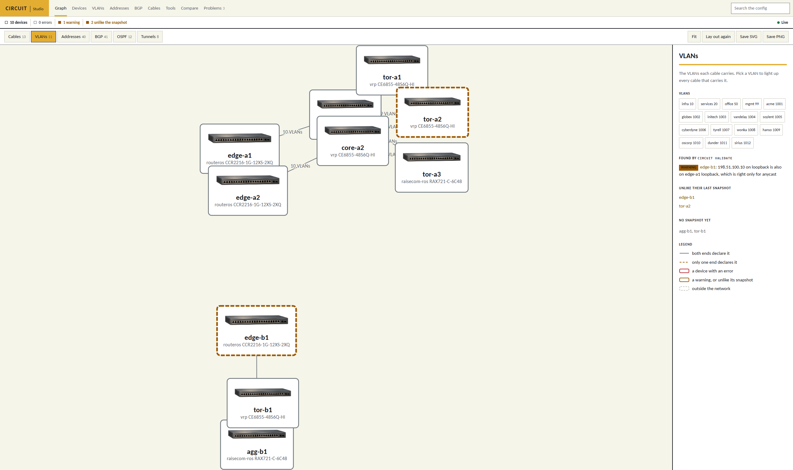
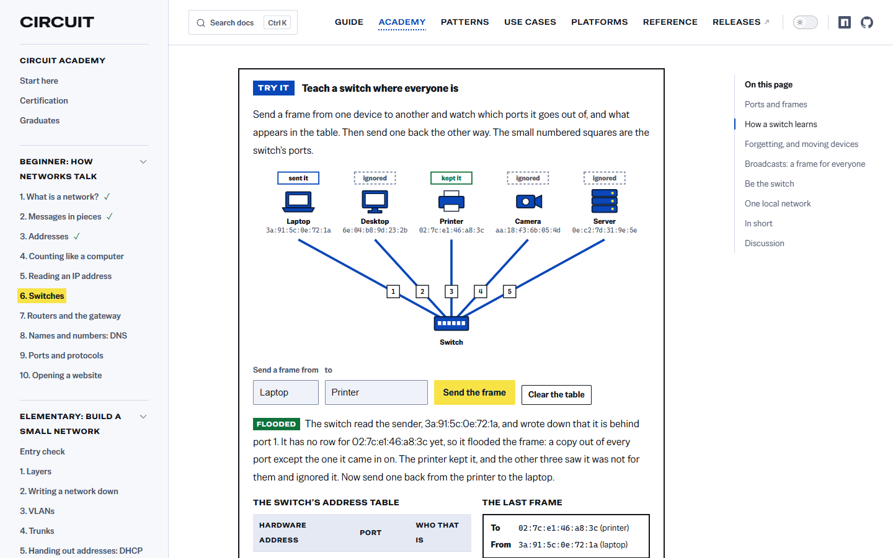

# Circuit

Write how each router and switch should be configured, in one TypeScript file per device. Circuit shows you what would change, then makes the device match.

Documentation: [circuit.tako.id](https://circuit.tako.id)

> [!WARNING]
> Circuit is in alpha. It runs a production network, but the way you write config, the commands and the supported devices can still change between releases. Install an exact version, and read the release notes before you upgrade.

## What it does

- **One file per device.** VLANs, ports, addresses, routing, firewall, users and services in TypeScript. Your editor checks every name as you type.
- **Same words for every vendor.** MikroTik RouterOS 7, Huawei VRP, Raisecom ROS, Juniper Junos and Fortinet FortiOS each get their own commands. Anything a device can't do is an error before anything is sent.
- **The file is the whole truth.** A port, user or service the file doesn't mention is removed or turned off, so nothing set by hand stays behind.
- **See every change first.** `diff` shows it offline, `apply` plans it against the live device, and nothing is sent without `--confirm`. On RouterOS, Junos and FortiOS a change undoes itself if Circuit can't log in again afterwards.
- **History in git.** Each device's last snapshot lives in `.circuit/state/`, so the repo's history is the network's history.
- **Your own rules.** Checks run on every change; presets give ready-made filters, BGP policies and checks.
- **Secrets stay out of the repo.** They come from `.env` or 1Password and never show up in a plan or a snapshot.
- **See the network.** `circuit studio` draws cables, VLANs, addresses, BGP, OSPF and tunnels in your browser, marks what's broken or differs from the device, and lists everything in tables for people who don't read TypeScript. It can run on a server for the whole team. `circuit graph` prints the drawing as Mermaid, DOT or JSON.
- **Keeps the rest in step.** Prefix lists from a registry, your PeeringDB record, LibreNMS, Prometheus targets, WireGuard client configs, and your BGP communities for a looking glass.
- **Safe with AI agents.** Every project gets an `AGENTS.md` that says what an agent may run; the last step stays yours.

<picture>
    <source media="(prefers-color-scheme: dark)" srcset="docs/public/screenshots/studio-dark.png">
    
</picture>

## Circuit Academy

New to networking? [Circuit Academy](https://circuit.tako.id/academy/) teaches it from the very start, in lessons you try in the browser rather than only read: packets, addresses, switches and routers first, then VLANs, DHCP, NAT and firewalls written down in Circuit, BGP and an edge router of your own, and on to running a provider network. A certification is coming.

<picture>
    <source media="(prefers-color-scheme: dark)" srcset="docs/public/screenshots/academy-dark.png">
    
</picture>

## Start

You need [Node.js](https://nodejs.org) 20.12 or newer, or [Bun](https://bun.sh). Then:

```bash
npx @takodotid/circuit new        # or: pnpm dlx @takodotid/circuit new, bunx @takodotid/circuit new
```

It asks which kind of network you have, creates a project with example devices, and installs Circuit. [Getting started](https://circuit.tako.id/guide/getting-started) walks through the first run.

Circuit supports MikroTik RouterOS 7, Huawei VRP V200R005, Raisecom ROS 6.5, Juniper Junos 21 and Fortinet FortiOS 6.2, at the versions on the [platforms page](https://circuit.tako.id/platforms/). Releases are on the [releases page](https://github.com/takodotid/circuit/releases), on npm and on GitHub Packages.

## Working on Circuit

```bash
bun install
bun run check       # everything CI runs: typecheck, tests, format, docs build, Node build
bun run test        # every example and template validates, and plans nothing against its own render
bun run docs:dev    # the documentation site, from docs/
```

[Contributing](https://circuit.tako.id/contributing) explains the layout, how to add a platform, and how releases are cut. `AGENTS.md` has the rules for changing the code, for people and AI agents alike; `.claude/skills/` has the step-by-step guides an agent loads, such as adding a device.

## License

[Business Source License 1.1](LICENSE): free in production for an organization whose yearly revenue and funding, with its affiliates, are each under US$100,000. Above that, production use needs a commercial license from [legal@tako.id](mailto:legal@tako.id). Each version becomes Apache License 2.0 four years after it is published. See [License](https://circuit.tako.id/license).
