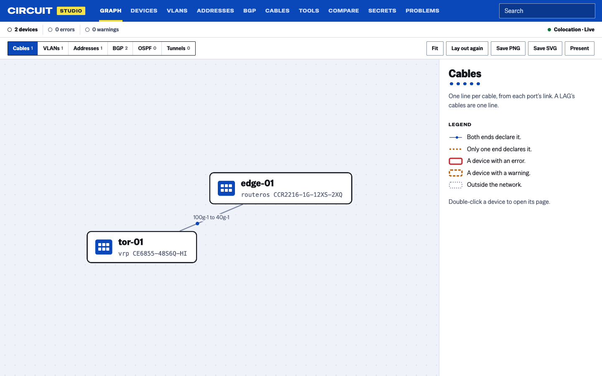

<p align="center">
    <a href="https://circuit.tako.id">
        <picture>
            <source media="(prefers-color-scheme: dark)" srcset="docs/public/logotype-dark.png">
            
        </picture>
    </a>
</p>

<p align="center"><b>Your network, written down.</b><br>One TypeScript file per device. Circuit shows what would change, then makes the device match.</p>

<p align="center">
    <a href="https://github.com/takodotid/circuit/actions/workflows/check.yml?query=branch%3Amain"></a>
    <a href="https://github.com/takodotid/circuit/releases"></a>
    <a href="https://www.npmjs.com/package/@takodotid/circuit"></a>
    <a href="LICENSE"></a>
    <a href="https://circuit.tako.id"></a>
</p>

<p align="center">
    <a href="https://circuit.tako.id/guide/install">Install</a> ·
    <a href="https://circuit.tako.id/guide/introduction">Guide</a> ·
    <a href="https://circuit.tako.id/academy/">Academy</a> ·
    <a href="https://circuit.tako.id/studio/">Studio</a>
</p>

You write each network device in its own TypeScript file: its ports, VLANs, addresses, routing, firewall, and users. Your editor checks every name and every port as you type. Circuit reads what the device runs, shows you the difference, and sends the change once you say yes. [Introduction](https://circuit.tako.id/guide/introduction) explains how it works.

Circuit works with MikroTik RouterOS 7, Huawei VRP, Raisecom ROS, Juniper Junos, and Fortinet FortiOS. [Platforms](https://circuit.tako.id/reference/platforms) shows what works on each.

## A device

```ts
// sites/site-a/switch-01.ts
import { as64500 } from "../../circuit";
import { site_a } from "./site";

export default as64500.device({
    name: "switch-01",
    site: "site-a",
    platform: "vrp",
    model: "CE6855-48S6Q-HI",
    connection: { host: "192.0.2.2", user: "netops" },
    system: {
        users: { netops: { role: "admin", password: secret("SWITCH_01_ADMIN_PASSWORD") } },
    },
    interfaces: {
        ethernet: {
            "10g-1": { description: "edge-01 sfp28-2", trunk_vlans: ["mgmt"], link: { device: "edge-01", port: "25g-2" } },
        },
        vlan_interface: {
            mgmt: { vlan: "mgmt", addresses: [site_a.addresses.switch] },
        },
    },
    switching: {
        vlans: { mgmt: site_a.vlans.mgmt },
    },
});
```

If you write the port `"10g-49"`, the editor shows an error, because this switch has no such port. A typo such as `trunk_vlans: ["mgnt"]` is an error too, and `circuit validate` asks `Did you mean mgmt?`. [How to write a project](https://circuit.tako.id/guide/project) shows the whole project.

## Circuit Studio

`circuit studio` draws the network and lists everything in the project, in your browser.

<picture>
    <source media="(prefers-color-scheme: dark)" srcset="docs/public/screenshots/studio-dark.png">
    
</picture>

## Install

- Linux and macOS: `curl -fsSL https://circuit.tako.id/install | sh`
- Windows, in PowerShell: `irm https://circuit.tako.id/install.ps1 | iex`

Then start a project with `circuit new network`, and open its folder in VS Code. Run `circuit` alone for a menu. [Install](https://circuit.tako.id/guide/install) has the details, and how updates work. [The circuit command](https://circuit.tako.id/reference/cli) lists every command.

## Contributing

```bash
bun install
bun run check   # runs every check
```

[CONTRIBUTING.md](CONTRIBUTING.md) explains how to change Circuit. [Decisions](DECISIONS.md) says what shaped it, and why.

## License

Circuit is source-available under the [Business Source License 1.1](LICENSE). A small organization uses it in production for free, and a larger one needs a commercial license. Each version moves to the Apache License 2.0 four years after it is published. [License and credits](https://circuit.tako.id/license) gives the limits.
